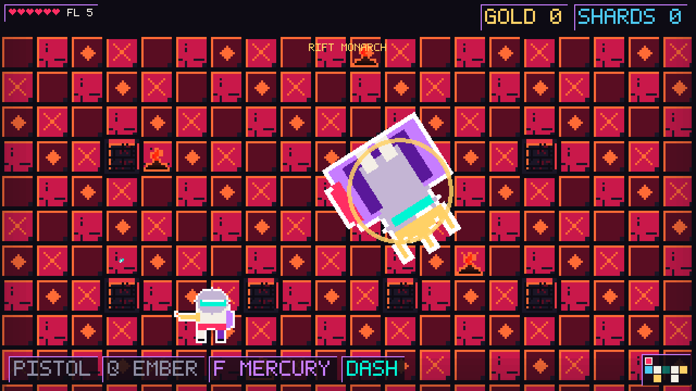

# riftrush

Endless pixel-art action roguelite. Dash, shoot, loot, die, repeat.

## Run

```bash
npm install
npm run dev
npm run build
npm run test
```

`npm run lint` checks ESLint. `npm run format:check` checks Prettier.

The dev server is http://localhost:5173. The production build uses `VITE_BASE` (default `/`). GitHub Pages publishes `main` to https://ganya002.github.io/riftrush/ with `VITE_BASE=/riftrush/`.

## Play

WASD or left stick to move. Mouse, right stick, or the direction you face to aim. Click, hold, or the right trigger to shoot. Space, Shift, or the left trigger to dash. E or the bottom face button to interact. Q and F are the two active relics (top and left face buttons). Esc pauses.

The canvas uses the largest integer scale that fills the window, and each room is framed so the floor reaches the edge of the screen. Sprites animate at 24 frames per second. Gold on the HUD is the gold in this run. The shard count is the bank you spend in the hub. The death summary can send you back into the same seed.

Pick a character in the hub, clear a room to unlock its doors, and descend. Gold pays the shop. Hearts pay the HP merchant. A cursed chest takes hearts, follows you, and bites. Dying banks shards the hub can spend.



Pixels stay crisp: integer canvas scale, integer camera zoom, `pixelArt`.
